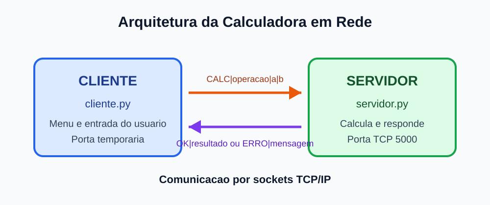

# Calculadora em Rede com Sockets

Projeto da disciplina **Fundamentos de Redes de Computadores**. A aplicacao permite que um cliente envie operacoes matematicas para um servidor pela rede. O servidor calcula o resultado e devolve uma resposta.

## Integrantes

- Adonias Pereira dos Santos Terceiro
- Nome do integrante 2
- Nome do integrante 3


## Arquitetura

A aplicacao possui dois processos:

- `servidor.py`: espera conexoes, recebe operacoes, calcula e responde;
- `cliente.py`: mostra o menu, recebe os dados do usuario e conversa com o servidor.



## Protocolo de transporte

Foi utilizado o **TCP**, pois ele cria uma conexao e entrega os dados de forma confiavel e na ordem correta. Isso e adequado para uma calculadora, porque cada operacao precisa chegar completa e cada resultado deve corresponder ao pedido enviado.

Se UDP fosse utilizado, seria necessario criar mecanismos adicionais para confirmar o recebimento, reenviar mensagens perdidas e identificar a ordem das mensagens.

## Endereco IP e porta

- Servidor na mesma maquina: `127.0.0.1`
- Servidor aceita conexoes em todas as interfaces: `0.0.0.0`
- Porta: `5000`

## Protocolo da aplicacao

Cada mensagem termina com uma quebra de linha (`\n`). Os campos sao separados pelo caractere `|`.

| Direcao | Formato | Exemplo |
|---|---|---|
| Cliente para servidor | `CALC|OPERACAO|NUMERO1|NUMERO2` | `CALC|SOMAR|10|5` |
| Cliente para servidor | `SAIR` | `SAIR` |
| Servidor para cliente | `OK|RESULTADO` | `OK|15` |
| Servidor para cliente | `ERRO|MENSAGEM` | `ERRO|Nao e possivel dividir por zero` |
| Servidor para cliente | `BYE|MENSAGEM` | `BYE|Conexao encerrada` |

Operacoes aceitas: `SOMAR`, `SUBTRAIR`, `MULTIPLICAR` e `DIVIDIR`.

## Requisitos

- Python 3.8 ou mais recente;
- nenhuma biblioteca externa.

Confira a versao instalada:

```powershell
python --version
```

No Windows, o comando tambem pode ser `py --version`.

## Como executar na mesma maquina

Abra um terminal na pasta do projeto e execute:

```powershell
python servidor.py
```

Deixe o servidor aberto. Em um segundo terminal, na mesma pasta, execute:

```powershell
python cliente.py
```

Se o Windows utilizar o inicializador `py`, troque `python` por `py`.

Escolha uma operacao no menu e informe dois numeros. Use a opcao `0` para encerrar o cliente. Para encerrar o servidor, pressione `Ctrl+C` no terminal dele.

## Como executar em dois computadores

1. Conecte os computadores na mesma rede.
2. Execute `ipconfig` no computador servidor e anote o endereco IPv4.
3. Libere a porta TCP 5000 no firewall, se necessario.
4. Inicie `python servidor.py` no servidor.
5. No computador cliente, execute `python cliente.py IP_DO_SERVIDOR`.

Exemplo:

```powershell
python cliente.py 192.168.1.20
```

## Arquivos da entrega

- `servidor.py`: codigo do servidor;
- `cliente.py`: codigo do cliente;
- `DOCUMENTACAO.md`: explicacao completa e respostas do projeto;
- `diagrama_arquitetura.svg`: diagrama solicitado;
- `WIRESHARK.md`: roteiro para gerar as evidencias reais de trafego;
- `ROTEIRO_APRESENTACAO.md`: roteiro para a apresentacao de ate 10 minutos.
- `TESTES.md`: registro dos testes funcionais realizados.
